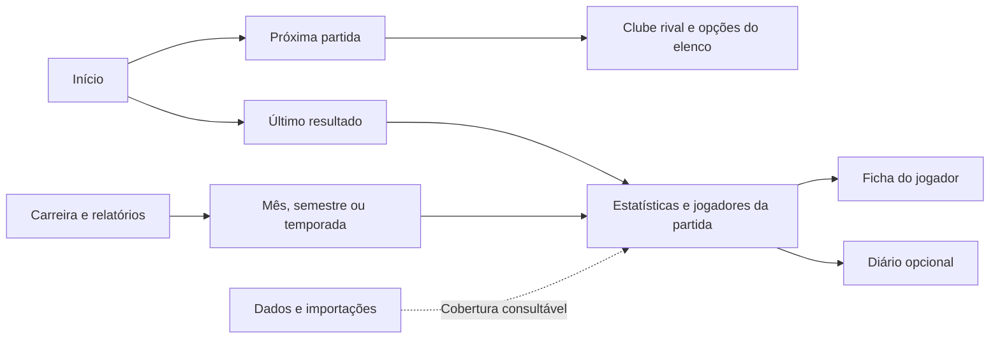

# Auditoria de UX e análise funcional do Atlas

**26/11/2026 · Project Atlas Tracker v1.2.7**

O Atlas já responde às principais perguntas do modo carreira. O trabalho de maior valor é organizar as respostas em torno do que o treinador vai fazer agora: preparar a próxima partida, rever a última, escolher entre jogadores e acompanhar a evolução do clube. A proposta reúne as 21 entradas atuais em seis áreas, mantém o detalhe acessível e aproveita os cálculos que já existem.

## Escopo e evidência

A auditoria cobre a árvore de trabalho Atlas sobre `9c2d510`, incluindo as alterações locais já presentes. O JavaScript servido pelo aplicativo corresponde byte a byte ao arquivo do workspace. Foram navegados no navegador a visão geral, a Central de partidas, a prévia de Stevenage, Resultados, a ficha de Reading e o relatório da temporada. As demais telas foram inventariadas pelo código. A cobertura esportiva foi consultada nas APIs locais, na carreira Plymouth Argyle, temporada 1, snapshot **111**, com data de jogo **15/03/2026**. O fichário e as políticas do Sheffield Hub foram consultados na cópia local em `A:/Projetos/ea-fc-sheffield-hub`, com HEAD `325481c5`. [Menu](../atlas/static/index.html#L20) · [Rotas](../frontend/src/shell.ts#L149) · [APIs](../atlas/server_http.py#L277)

| O que foi conferido | Evidência no corte |
| --- | --- |
| Calendário e resultados | 54 jogos concluídos e 13 agendados em cinco competições. |
| Cobertura de partida | 49 jogos com MatchStats detalhado e cinco sem export elegível nesse corte. Os nove indicadores coletivos de `metric_evidence` estavam disponíveis para o Plymouth nos 49 jogos detalhados, incluindo os dois tipos de xG. |
| Jogo com detalhe | Reading 0 × 2 Plymouth, fixture `1689`, em 14/03/2026. A API trouxe 27 participantes com detalhe, 3 × 13 finalizações e estimativa de formação inicial para ambos. A UI exibiu placar, estatísticas, jogadores, diário, eventos sem minuto e análise da comissão já disponível. |
| Jogo com cobertura básica | Plymouth × Eyüpspor, fixture `10988`, em 18/07/2025. A API trouxe uma linha de desempenho e nenhum participante com MatchStats. A ficha pode manter o placar e os registros básicos disponíveis. |
| Rotação | 49 jogos com XI identificável pelo contrato da rotação, 44 comparáveis ao jogo imediatamente anterior e 10 fora da comparação. Força rival pré-jogo disponível nos 54. A estimativa de formação é um dado distinto do conjunto de 11 jogadores. |
| Relatórios por período | A API mensal retornou nove meses com jogos e 61 atletas no universo do consolidado. Março de 2026 respondeu em JSON e Markdown. O semestre jan–jun retornou 19 jogos, 17 com export, e marcou março como mês parcial. |
| Academia | 16 fichas de jovens e nenhum plano registrado na resposta da API para esse snapshot. A presença do cadastro dá suporte à evolução de GER e potencial quando há observações em mais de um corte. |

O snapshot estava marcado como degradado com aviso sobre valores de lucratividade de equipes. A cobertura de partidas e métricas acima foi conferida por fonte e por fixture. Os números descrevem este corte da carreira. Foram executados 24 testes focados em relatório mensal, semestre, rotação, formação e evidência, com resultado OK. Escrita de registros manuais, geração de IA e captura dentro do FC26 ficaram fora da verificação. [Contrato de evidência](../atlas/metric_evidence.py#L17) · [Relatórios mensais](monthly-reports.md) · [Rotação](../atlas/rotation_analysis.py#L95)

## Mapa das telas e funcionalidades atuais

| Grupo | Tela ou entrada | Informação e caminho atual | Acesso proposto |
| --- | --- | --- | --- |
| Carreira | Visão geral | Painel do clube, partidas recentes e futuras, competições, destaques e snapshots. Abre fichas de clube, jogador, competição e jogo. | **Início**, com próxima e última partida em destaque. |
| Carreira | Linha do tempo | Eventos de carreira e movimentações em ordem cronológica. | **Carreira › Histórico**. |
| Carreira | Dados históricos | Temporadas manuais, competições, colocações, estatísticas por competição, transferências, empréstimos e revisões. | **Carreira › Histórico › Dados manuais**. |
| Partidas | Central de partidas | Próximo jogo, sequência recente, próximos compromissos e situação em competições. | **Partidas › Central**. |
| Partidas | Calendário | Jogos futuros, filtros de lista e acesso à ficha. | **Partidas › Calendário**. |
| Partidas | Resultados | Jogos concluídos, competição, placar, disponibilidade de detalhe e acesso à ficha. | **Partidas › Resultados**. |
| Partidas | Competições | Competições acompanhadas e ligas/mundo, com acesso a tabelas, fases, calendário e líderes quando disponíveis. | **Partidas › Competições**. |
| Elenco | Elenco | Lista e perfil cadastral dos jogadores, métricas de temporada, opções de recorte e acesso à ficha. | **Elenco › Profissional**. |
| Elenco | Contratos | Contratos importados, estrutura salarial por posição, destaques e lista completa. | **Elenco › Gestão › Contratos**. |
| Elenco | Transferências | Histórico por temporada, movimentos observados e registros manuais. | **Elenco › Gestão › Transferências**. |
| Elenco | Empréstimos | Entradas e saídas por empréstimo, com histórico e registro manual. | **Elenco › Gestão › Empréstimos**. |
| Elenco | Base FC26 | Academia, GER/potencial, trajetória e planos individuais disponíveis. | **Elenco › Base**. |
| Análises | Comissão técnica | Diagnóstico do time, forma recente, comparações de posição e função, referências e interpretação assistida. Também existe como aba em Análises. | **Análises › Comissão**, com atalhos nas fichas. |
| Análises | Análises | Visão geral, dados de partidas, rotação, comissão, leitura do elenco e comparação entre temporadas. | **Análises**, com desempenho, rotação e profundidade. Comparação vai para **Carreira**. |
| Análises | Recordes | Marcas de jogadores, partidas, sequências e transferências por período. | **Carreira › Recordes**. |
| Análises | Relatório da temporada | Resumo, semestre, competições, elenco, transferências, prêmios e qualidade. Impressão/PDF, CSV de resumo e cartões PNG. | **Carreira › Relatórios**, com mês, semestre e temporada. |
| Análises | Comparar snapshots | Jogadores que entraram ou saíram do recorte, evolução, contratos, resultados novos e variação estatística. | **Carreira › Histórico › Comparar cortes**. |
| Análises | Snapshots | Histórico de importações, arquivos, capacidades, avisos e evidência por partida e indicador. | **Dados › Snapshots e cobertura**. |
| Sistema | Importações | AutoCapture, pulsos de carreira/transferência, MatchStats e logs. Inclui operação de reset. | **Dados › Importações**, com reset em área administrativa de acesso explícito. |
| Sistema | Biblioteca de mídia | Fontes e associação de imagens a entidades. | **Dados › Mídia**. |
| Sistema | Configurações | Pasta de exportação, referências, workspaces, opções de mídia e de IA. | **Dados › Configurações**. |

Atalhos de busca e cabeçalho completam a navegação. **Ficha de partida** reúne placar, contexto, equipe e rival, jogadores, MatchStats, eventos, diário e comissão. **Ficha de jogador** reúne visão geral, produção da temporada, partidas, desenvolvimento, atributos, análise e comissão. **Ficha de clube** tem elenco, jogos, competições, liga/evolução e mídia/nome. **Ficha de competição** tem tabela ou fase, jogos e líderes conforme disponibilidade. Essas quatro fichas continuam abrindo a partir das entidades onde aparecem. [Visão geral e elenco](../frontend/src/views_overview.ts) · [Partidas e competições](../frontend/src/views_matches.ts) · [Pessoas e clubes](../frontend/src/views_people.ts) · [Histórico e importações](../frontend/src/views_history.ts) · [Análises e relatórios](../frontend/src/views_analysis.ts) · [Histórico manual](../frontend/src/views_manual.ts) · [Mídia e configuração](../frontend/src/views_media.ts)

## Problemas prioritários

| Achado | Efeito no uso | Mudança proposta |
| --- | --- | --- |
| A aba **Evolução mensal** descrita na documentação está ausente do menu atual. A API do mês e a saída Markdown funcionaram na auditoria. | O treinador encontra semestre e temporada, mas perde o caminho para revisar o mês e baixar aquele recorte. | Restaurar a visualização mensal a partir do serviço já disponível. Manter seleção e exportação de mês, semestre e temporada com o corte visível. [Tela atual](../frontend/src/views_analysis.ts#L298) · [Documentação mensal](monthly-reports.md) |
| Após abrir o relatório da temporada e navegar por Partidas até uma ficha, o conteúdo do relatório apareceu com o breadcrumb **Partida**. | Uma resposta atrasada pode sobrescrever a tela pedida e apresentar um contexto contraditório. | Vincular a resposta à navegação e ao corte que a iniciaram. Usar como referência a proteção já aplicada a Análises e à ficha de partida. [Relatório](../frontend/src/views_analysis.ts#L399) · [Proteção em Análises](../frontend/src/views_analysis.ts#L414) |
| A ficha concluída espera a consulta de relatório em cache antes de montar sua visão principal. O cache recalcula o contexto para validar a origem. Em uma abertura observada a ficha ainda carregava depois de 14 segundos. | O placar e os dados objetivos ficam atrás da espera pela comissão. O perfil do atleta também abre por padrão na Comissão e pode solicitar um trabalho em segundo plano. | Mostrar primeiro resultado, números e ficha do atleta. Buscar cache e estado da comissão de forma independente. Leitura da ficha e geração de texto viram ações distintas. [Ficha de partida](../frontend/src/views_matches.ts#L143) · [Ficha do jogador](../frontend/src/views_people.ts#L198) · [Consulta de cache](../atlas/commission.py#L3821) |
| A consulta da Comissão na UI envia temporada, com omissão do snapshot. O servidor escolhe a importação mais recente da temporada nesse caso. | O cabeçalho pode mostrar um corte histórico enquanto a comissão usa outro. É uma divergência de contrato identificada no código. | Levar o snapshot efetivo em todas as consultas e exibir a data usada caso o usuário escolha outro período. [Consumo](../frontend/src/views_analysis.ts#L437) · [Regra de seleção na API](../atlas/server_http.py#L363) |
| Visão geral, Central, Calendário e Resultados sobrepõem parte da mesma jornada. Comissão tem duas entradas. Navegação e cabeçalhos misturam português e inglês. | O caminho para a próxima ação depende de decorar rótulos e distinguir listas semelhantes. | Eleger uma entrada principal por tarefa, conservar filtros e voltar ao ponto de origem. Aplicar o idioma ativo ao menu, à ficha, aos estados vazios e a termos de tabela. [Menu](../atlas/static/index.html#L20) · [Comissão em Análises](../frontend/src/views_analysis.ts#L94) |
| O selo de detalhe aparece em Resultados, a cobertura por indicador em Snapshots e o diagnóstico de captura em Importações. | O usuário precisa trocar de tela para entender se o jogo tem só registro básico ou se uma captura ainda pode chegar. | Mostrar um estado curto junto ao placar e dar acesso dirigido à origem ou ao diagnóstico existente. Manter estado da importação separado da cobertura esportiva por campo. [Cobertura e logs](../frontend/src/views_history.ts#L24) · [Estados do contrato](../atlas/metric_evidence.py#L40) |

## Experiência proposta

O cabeçalho mantém **carreira · temporada · dados até [data]**. Quando o pulso da carreira avança sem snapshot completo novo, mostra também a **data atual no jogo**. O corte histórico recebe indicação visível e ação **Voltar ao último registro**. Ao navegar de um mês para um jogo ou do elenco para um atleta, o corte acompanha a ficha. Ao voltar, filtros, posição da lista e foco voltam com ela.

| Jornada | Primeira leitura | Detalhe quando o treinador quiser |
| --- | --- | --- |
| **Voltei ao save** | No Início, próximo compromisso e último resultado, com data, adversário e placar quando jogado. Abaixo, sequência recente e posição de liga se disponível. | Abrir a partida, o calendário completo ou a competição. O estado da captura aparece aqui quando a fonte o associa a uma partida ou à carreira. |
| **Vou jogar a próxima** | Prévia com competição, data, mando, rival e contexto disponível no corte. Ação **Ver opções do elenco**. | Perfil rival, classificação e forma quando há evidência anterior ao jogo. Comparação por posição, minutos e forma do próprio elenco. Diário disponível para quem quiser registrar um plano. |
| **Acabei de jogar** | Ficha pós-jogo com placar, estado do detalhe e até três referências que ajudem a ler o jogo, como finalizações, NPK-xG e participantes quando disponíveis. | Comparativo coletivo, tabela filtrável dos dois times, eventos exportados, diário e comissão. A cobertura abre dentro da ficha. Os jogos em captura ou sem vínculo têm caminhos distintos para diagnóstico, desde que exista evidência associável. |
| **Estou em dúvida entre dois jogadores** | Elenco por posição, com minutos, jogos avaliados, forma, GER e posição cadastrada. A ficha abre pelo resumo esportivo. | Reusar a comparação existente da comissão para os pares no mesmo recorte. Exibir posição observada com origem quando houver, taxa por 90 com seus minutos e link para partidas. Exibir todos os atletas aplicáveis após os destaques. |
| **Vou virar o mês ou a temporada** | Relatório no período escolhido, com campanha, gols, pontos de liga, cobertura e atletas com evidência. | Abrir os jogos e atletas do período, alternar competição quando suportado e exportar o recorte efetivamente selecionado. Março incompleto no corte recebe etiqueta **Em andamento**. |
| **Vou acompanhar a base ou a janela** | Na Base, GER, potencial, evolução documentada e plano opcional. Em Gestão, prazos explícitos de contrato, empréstimos e movimentos. | Ficha do jovem e trajetória de transição observada. Nos movimentos, mostrar data, origem e estado **observado**, **manual** ou **estimado** conforme a fonte. |

Na ficha de Reading, por exemplo, o primeiro bloco pode ser **Reading 0 × 2 Plymouth · League One · 14/03/2026 · Detalhe disponível**. A linha abaixo mostra **Finalizações 3 × 13** e **NPK-xG 0,86 × 4,98**, na ordem mandante–visitante. O conteúdo restante fica em **Estatísticas · Jogadores · Diário · Comissão**. Uma ficha de jogo futuro abre com **Pré-jogo**, próxima data e contexto disponível. Para uma ficha básica, **Detalhe indisponível neste corte** acompanha o placar e as notas/minutos realmente presentes.

## Relatórios e limites dos dados

| Relatório | Fonte e evolução proposta | Condição de leitura |
| --- | --- | --- |
| **Pós-jogo** | Fixtures para resultado, MatchStats elegível para coletivo e individual, observações de partidas para notas/minutos quando aplicáveis. Reordenar a ficha existente e reutilizar seus links. | Contagem de eventos exportados. Minutos de eventos, ordem cronológica confirmada e formações finais ficam indisponíveis sem fonte válida. |
| **Últimos jogos** | Atalho de forma no Início e em Análises, com janela fixa claramente rotulada e lista de jogos. É a adaptação do relatório recorrente do Hub para o ritmo do save. | Para o clube, considerar a sequência de jogos da carreira. Para atleta, considerar aparições válidas conforme a regra do relatório. Indicar quantos jogos e minutos sustentam cada recorte avançado. |
| **Rotação e profundidade** | Reusar continuidade do XI e filtros de competição, mando, força e formação estimada. Ligar à profundidade por posição e à ficha de cada atleta. | Manter a regra de três jogos por grupo para comparar. Retenção do XI descreve a troca entre partidas. O resultado é descritivo e agregado ao jogo inteiro. |
| **Mensal, semestral e temporada** | Reusar serviço mensal, agregação semestral e relatório de carreira. Expor jogos, resultados, evolução do elenco, qualidade e saídas existentes. | Mês usa data do fixture. Totais oficiais de temporada permanecem com fonte própria e pontos se restringem à liga. CSV/PNG de resumo devem ser rotulados como tal até haver exportação do recorte correspondente. |
| **Atleta e goleiros** | Combinar perfil cadastral, histórico de GER/POT, registros por jogo e métricas detalhadas com a cobertura de cada origem. Reusar o serviço de goleiros. | Nota informa aparições avaliadas. Taxa por 90 usa os minutos cobertos pelo indicador. Quando a atribuição entre goleiros é incerta, manter a exposição no coletivo e os registros individuais disponíveis. |
| **Base e gestão** | Usar cadastro e evolução de academia, planos do treinador, contratos e movimentações observadas ou registradas. | A primeira observação no profissional prova vínculo naquele corte. Atuação 5x5, carga da base e motivo da mudança dependem de evidência própria. |
| **Comissão** | Consumir os mesmos números e recortes que a tela objetiva. Mostrar conclusões, jogos de apoio e estado do relatório. | Hipóteses recebem rótulo e limites. O usuário consegue rever dados mesmo sem relatório gerado, com cache antigo ou com provedor indisponível. |

### Do Sheffield Hub para o Atlas

| Referência no Hub | Decisão para o Atlas |
| --- | --- |
| `docs/central-paineis.md`, `docs/jogadores/` e `docs/cobertura-paineis.md` | Aproveitar atalhos orientados a perguntas, destaques ligados à ficha e universo completo acessível. Atlas já tem listas e fichas que suportam esse desenho. |
| `docs/relatorios-semanais.md` e `docs/gestao-minutos.md` | Adaptar a leitura de jogos recentes e utilização de atletas à sequência do save. Usar minutos conhecidos com cobertura. Relatório por calendário real e alertas de carga física ficam fora do primeiro ciclo. |
| `docs/comissao-tecnica.md` e `docs/nota-por-posicao-funcao.md` | Mostrar opções por posição, amostra e comparáveis. A separação entre posição de cadastro, desempenho registrado e decisão do treinador é reaproveitável. O XI recomendado e a hierarquia formal do Sheffield dependem de regras e contexto daquele save. |
| `docs/completude-estrutural-e-evidencia.md` | Adotar a distinção entre haver um pacote e haver evidência de um indicador. Usar os estados do Atlas e seu vocabulário de captura. |
| `docs/contrato-json-partidas-profissional.md` e `docs/pressao-momentum-qualitativa.md` | O Hub registra prints e leitura visual por faixas, inclusive da tela de Ameaça. Atlas tem diário para observação manual. Posse percentual, momentum numérico, pressão por faixa e instruções táticas automáticas pedem fonte específica. Passes certos e recuperações de posse continuam com seus próprios rótulos. |
| `docs/defesa-setores-combinacoes.md` e `docs/contexto-defensivo-escalacao.md` | Exibir ações defensivas observadas, contexto de equipe e estimativas explicitamente rotuladas. Minutos de dupla em campo, efeito de substituição e causalidade exigem cronologia e atribuição que a fonte atual descrita não sustenta. |
| `docs/base-radar.md` e `docs/metodologia-base.md` | Reusar a ideia de acompanhar jovens e registrar próximos passos. GER, potencial e trajetória cadastral têm suporte. Índice de torneio 5x5 e rotação por minutos de base ficam condicionados a fonte demonstrada. |

A matriz técnica existente mantém a relação de métricas e restrições por item. Três exemplos afetam diretamente o rótulo na interface. **NPK-xG** é o campo extraído sem pênaltis, **xG total da equipe** é a derivação do Atlas quando há contexto de pênaltis, e **formação inicial estimada** depende de slots, posições e vínculo elegíveis. Mudanças de elenco entre snapshots representam mudança observada de vínculo até que um evento de mercado dê suporte ao tipo de transação. [Matriz Hub → Atlas](plano-evolucao-2026-11-10/matriz-reaproveitamento-hub-atlas.md) · [Formação](../atlas/match_lineups.py#L51) · [Métricas](../atlas/match_stats.py) · [Goleiros](../atlas/goalkeeper_metrics.py)

### Estados que a interface deve distinguir

| Estado | Comportamento esperado |
| --- | --- |
| **Pré-jogo** | Mostra compromisso e contexto prévio. A ficha usa os dados da carreira até o corte. |
| **Só dados básicos** | Mostra placar e registros básicos disponíveis. O detalhe avançado aparece como **Indisponível neste corte**. |
| **Captura parcial ou vínculo pendente** | Explica o motivo quando a origem é identificável. Uma captura sem fixture confiável permanece na fila de importações. |
| **Detalhe disponível** | Mostra a fonte por bloco ou campo. Métrica ausente tem valor **N/D**. Zero confirmado aparece como **0**. |
| **Amostra curta** | Mantém as partidas e os valores observados visíveis. Comparações, rankings e conclusões aplicam o limiar do relatório. |
| **Conflito ou dado manual** | Identifica a origem e permite consultar o registro. Revisões do diário e dados manuais preservam autoria e escopo. |
| **Carregando ou erro** | Mantém abas e filtros visíveis, mostra o progresso junto ao bloco e oferece nova tentativa localizada. Resposta antiga é descartada após mudança de tela ou corte. |

## Ordem de entrega e critérios de aceite

| Prioridade | Entrega | Critérios verificáveis |
| --- | --- | --- |
| **1** | Restaurar relatório mensal e proteger escopo e navegação. Reusar a consulta e o Markdown atuais. | Março de 2026 abre no corte 111, mostra estado parcial e exporta o mesmo período. Uma troca rápida de Relatório para Partida conserva o conteúdo e o breadcrumb da Partida. Se o usuário selecionar um snapshot anterior da mesma temporada, a Comissão usa a data efetiva indicada. |
| **2** | Reorganizar Início, Partidas e Elenco e abrir as fichas com dados objetivos. Consolidar menus e tradução. | Há ação direta para o próximo jogo e para o último resultado. Reading mostra o placar e as finalizações enquanto a comissão carrega. Um fixture sem detalhe mantém seu placar, os dados básicos existentes e o motivo de cobertura. Ao voltar da ficha, filtros e foco são recuperados. Controles funcionam por teclado e o status tem texto legível. |
| **3** | Dar saída esportiva aos dados já capturados. Juntar forma, pares por posição, rotação e relatórios à navegação reorganizada. | A lista completa é acessível a partir dos destaques. Comparação de dois atletas exibe período, minutos, jogos e fonte. Rotação mostra grupos e exclusões. Filtros que deixam a amostra abaixo do mínimo exibem o motivo. Dados básicos e avançados permanecem identificáveis no relatório e na exportação. |
| **Quando houver evidência nova** | Considerar observação estruturada a partir de um print específico, eventos detalhados ou dados jogados da base. | Cada campo começa com origem e cobertura demonstradas para uma partida ou jovem. Uma observação confirmada pelo treinador aparece com origem manual. Prints ilegíveis ou sem vínculo deixam o campo indisponível. |

O primeiro ciclo cabe no frontend e nas consultas existentes. A reformulação proposta é de navegação e leitura esportiva, com o diário e a comissão acionados conforme o interesse do treinador. A sequência de engenharia e os contratos de evidência permanecem detalhados no plano de evolução. [Plano de evolução](plano-evolucao-2026-11-10/README.md) · [Diário](../atlas/match_diary.py) · [Semestre](../atlas/semester_report.py)
